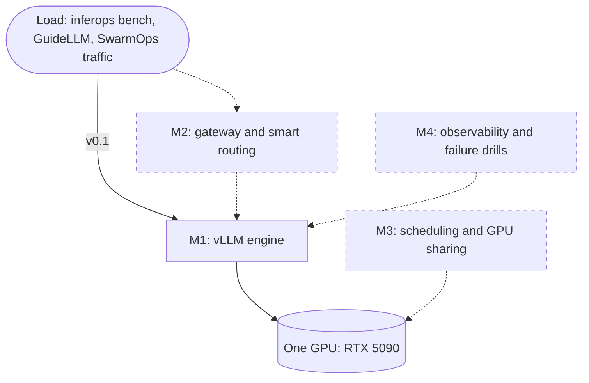

# InferOps

[](https://github.com/ltan0136/inferops/actions/workflows/ci.yml)


**A mini inference cloud on a single GPU.** Serve an LLM with vLLM on Kubernetes, then measure
it, route it and keep it up, with numbers anyone can reproduce.

[中文说明](README.zh-CN.md)

InferOps is the platform layer under [SwarmOps](https://github.com/ltan0136/swarmops): SwarmOps
produces agent traffic, InferOps serves the model behind it.

**Status: v0.1, the first part of milestone M1.** What works today:

- **Serving:** Kubernetes manifests for vLLM on a one-GPU k3s node, with a pinned image, a
  rollout that releases the GPU first, and a startup probe sized for the first model download.
- **Benchmarking:** `inferops bench`, a closed-loop load generator that sweeps concurrency and
  reports TTFT, TPOT, latency percentiles and throughput.
- **Runs without a GPU:** a mock OpenAI-compatible server drives the whole benchmark path in
  tests and CI.

Results from the RTX 5090 are not published yet. They arrive with the first M1 report.

## Architecture

Solid lines are what v0.1 runs. Dashed parts are planned (see the [roadmap](docs/roadmap.md)).



## Quickstart (no GPU)

```bash
python -m venv .venv && source .venv/bin/activate
make install
make bench-smoke
```

`make bench-smoke` starts the mock server in-process, sweeps concurrency from 1 to 16 and
writes the run to `results/`. The mock serves 8 requests at once, so the table shows the shape
a saturated engine produces: throughput stops growing and time to first token climbs.

Output of one run (latencies in milliseconds):

| concurrency | req/s | output tok/s | TTFT p50 | TTFT p99 | TPOT p50 | TPOT p99 | latency p50 | latency p99 | failed |
| ---: | ---: | ---: | ---: | ---: | ---: | ---: | ---: | ---: | ---: |
| 1 | 3.85 | 77.1 | 53.9 | 54.4 | 10.7 | 10.9 | 257.4 | 260.5 | 0 |
| 2 | 7.51 | 150.2 | 55.3 | 57.4 | 11.0 | 11.1 | 264.1 | 266.7 | 0 |
| 4 | 14.33 | 286.6 | 57.9 | 63.2 | 11.4 | 11.7 | 274.4 | 281.0 | 0 |
| 8 | 26.52 | 530.3 | 62.3 | 92.4 | 11.9 | 12.4 | 288.3 | 319.2 | 0 |
| 16 | 26.29 | 525.7 | 319.1 | 324.6 | 11.9 | 12.3 | 545.6 | 555.5 | 0 |

These numbers describe the mock, not a model. Going from 8 to 16 streams adds no throughput
and multiplies TTFT by five: the extra requests are waiting in the queue.

## Run it on a GPU

1. Prepare the node: [deploy/README.md](deploy/README.md) (NVIDIA Container Toolkit, k3s,
   device plugin).
2. Deploy vLLM and wait for the model to load:

   ```bash
   make deploy-vllm
   ```

3. Benchmark it:

   ```bash
   make port-forward     # terminal 1
   make bench            # terminal 2
   ```

Each run writes `summary.md`, `summary.csv`, `summary.json` and the raw `requests.jsonl` to
`results/<scenario>-<utc-time>/`. The scenario is a YAML file:
[bench/scenarios/baseline.yaml](bench/scenarios/baseline.yaml).

## What the benchmark measures

| Metric | Definition |
| --- | --- |
| TTFT | request sent → first streamed token |
| TPOT | (end of stream − first token) / (output tokens − 1) |
| Latency | request sent → end of stream |
| Throughput | successful requests, and their output tokens, per measured second |

Exact definitions, the matching vLLM server metrics and the known limits of a closed-loop test
are in [docs/metrics.md](docs/metrics.md).

Three choices keep the numbers honest:

- Every prompt starts with a unique marker, so the prefix cache cannot make the server look
  faster than it is.
- Token counts come from the server's usage block. If a server sends none, the report says the
  counts are estimated.
- A failed request is counted as failed and never enters latency or throughput. A level with
  no successful request stops the run.

## Design decisions

- [ADR 0001](docs/adr/0001-single-node-k3s-with-the-nvidia-device-plugin.md): single-node k3s
  with the NVIDIA device plugin
- [ADR 0002](docs/adr/0002-vllm-as-the-first-engine.md): vLLM as the first engine, with a
  pinned image
- [ADR 0003](docs/adr/0003-own-load-generator-cross-checked-with-guidellm.md): an in-repo load
  generator, cross-checked with GuideLLM

## Roadmap

| Milestone | Goal | Status |
| --- | --- | --- |
| M1 | Inference baseline: one model, one GPU, honest curves | in progress |
| M2 | Gateway and smart routing across replicas | planned |
| M4 | Observability and failure drills | planned |
| M3 | Scheduling and GPU sharing, with a simulated cluster | planned |

Details: [docs/roadmap.md](docs/roadmap.md).

## Repository layout

```text
src/inferops/bench/   load generator, metrics, report
src/inferops/mock/    mock OpenAI-compatible server
bench/scenarios/      benchmark definitions (YAML)
deploy/vllm/          Kubernetes manifests
docs/                 metric definitions, roadmap, decision records
tests/                everything runs against the mock server
```

## Development

```bash
make test      # no GPU, no network
make lint
make help      # every target
```

## License

MIT
